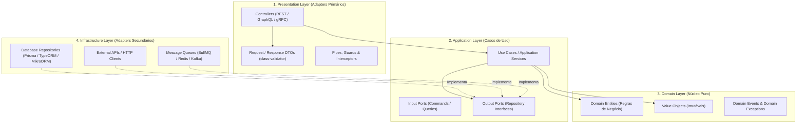

# NestJS Skill: Clean Architecture, Injeção de Dependências e Escalabilidade

Esta skill orienta a construção de aplicações backend de nível empresarial com **NestJS**, focando em arquitetura limpa, alta manutenibilidade, desacoplamento rigoroso via inversão de dependência (IoC/DI) e escalabilidade para microsserviços e sistemas de alto tráfego.

---

## Quando Utilizar Esta Skill

Consulte e ative esta skill ao:
1. Projetar novos projetos ou módulos backend utilizando **NestJS** com Node.js e TypeScript.
2. Estruturar o sistema em **Clean Architecture / Arquitetura Hexagonal (Ports & Adapters)**, separando domínio de infraestrutura.
3. Aplicar rigorosamente os princípios **SOLID**, em especial Inversão de Dependência (DIP) e Responsabilidade Única (SRP).
4. Configurar **Injeção de Dependência** avançada (`useClass`, `useFactory`, tokens `Symbol` ou `abstract class`, escopos de injeção).
5. Otimizar a performance e a taxa de transferência de I/O com **Fastify adapter** (`@nestjs/platform-fastify`).
6. Implementar processamento assíncrono e mensageria com **BullMQ / Redis** e arquiteturas orientadas a eventos.
7. Construir pipelines resilientes com interceptors de timeout, circuit breaker e rate limiting (`@nestjs/throttler`).
8. Padronizar tratamento global de erros (RFC 7807), validação estrita de DTOs (`class-validator`) e documentação Swagger/OpenAPI.
9. Escrever testes automatizados (Unitários, Integração e E2E) assegurando o guardrail mandatório de **cobertura mínima de 80%**.

---

## 1. Blueprint Arquitetural: Clean Architecture no NestJS



### Regras de Ouro das Camadas:
- **Domain Layer:** Não possui NENHUMA dependência de bibliotecas externas, frameworks ou do `@nestjs/common`. Classes puras TypeScript.
- **Application Layer:** Orquestra o fluxo de negócio, executa validações de domínio e interage com o exterior unicamente através de **Portas (Interfaces/Classes Abstratas)**.
- **Infrastructure Layer:** Implementa as portas definidas pela aplicação. Contém detalhes de banco de dados, drivers e APIs externas.
- **Presentation Layer:** Recebe as requisições, valida tipos e limites de entrada via DTOs e despacha para os Use Cases. Não contém lógica de negócio.

---

## 2. Princípios SOLID Aplicados ao NestJS

### 2.1. S - Single Responsibility Principle (SRP)
- **Controllers** apenas recebem requisições HTTP, delegam para o Use Case e formatam a resposta. Nunca execute queries de banco nem cálculos de negócio dentro de um Controller.
- **Use Cases** executam exatamente um fluxo de negócio (ex: `CreateUserUseCase`, `CancelOrderUseCase`).
- **Repositories** tratam apenas da persistência e hidratação das entidades.

### 2.2. O - Open/Closed Principle (OCP)
- Use **Strategy Pattern** e **Dynamic Modules** (`forRoot`, `forFeature`) para permitir extensão de comportamento sem alterar módulos centrais (ex: múltiplos provedores de pagamento ou envio de e-mails configurados via tokens).

### 2.3. L - Liskov Substitution Principle (LSP)
- Implementações de repositório (ex: `PrismaUserRepository`, `InMemoryUserRepository`) devem respeitar rigorosamente o contrato da porta `UserRepository`. Testes de Use Cases devem rodar contra o repositório em memória com o mesmo comportamento do repositório real.

### 2.4. I - Interface Segregation Principle (ISP)
- Não crie interfaces monolíticas com dezenas de métodos. Prefira interfaces pequenas e segregadas:
  ```typescript
  export interface UserReader {
    findById(id: string): Promise<User | null>;
  }
  
  export interface UserWriter {
    save(user: User): Promise<void>;
    delete(id: string): Promise<void>;
  }
  ```

### 2.5. D - Dependency Inversion Principle (DIP)
- **Regra Estrita:** A camada de aplicação e os controllers NUNCA devem depender diretamente de classes concretas de infraestrutura (como `PrismaService` ou repositórios concretos).
- Use **Classes Abstratas como Tokens de Injeção** no NestJS:
  ```typescript
  // 1. Porta (Abstração)
  export abstract class OrderRepository {
    abstract save(order: Order): Promise<void>;
    abstract findById(id: string): Promise<Order | null>;
  }

  // 2. Use Case depende da Abstração
  @Injectable()
  export class CreateOrderUseCase {
    constructor(private readonly orderRepository: OrderRepository) {}
    
    async execute(input: CreateOrderInput): Promise<OrderOutput> {
      // Regra de negócio pura
    }
  }

  // 3. Módulo vincula a Abstração à Implementação Concreta
  @Module({
    providers: [
      CreateOrderUseCase,
      {
        provide: OrderRepository,
        useClass: PrismaOrderRepository, // Infraestrutura
      },
    ],
  })
  export class OrderModule {}
  ```

---

## 3. Injeção de Dependências & Modularidade

### 3.1. Tipos de Providers
- **`useClass`**: Mapeia um token para uma classe de implementação concreta.
- **`useFactory`**: Permite criação dinâmica e assíncrona de instâncias com injeção de dependências:
  ```typescript
  {
    provide: 'REDIS_CLIENT',
    useFactory: async (configService: ConfigService) => {
      const client = new Redis(configService.getOrThrow('REDIS_URL'));
      return client;
    },
    inject: [ConfigService],
  }
  ```
- **`useValue`**: Útil para constantes de configuração e mocks em testes unitários.

### 3.2. Escopos de Injeção e Performance
- **`DEFAULT` (Singleton - Obrigatório por padrão):** O provider é instanciado uma única vez na inicialização da aplicação e compartilhado entre todas as requisições. Máxima performance e menor consumo de memória.
- **`REQUEST` (Evitar sempre que possível):** Uma nova instância é criada para CADA requisição HTTP recebida. Causa degradação massiva de performance em rotas de alta frequência. Use apenas para isolamento crítico de multi-tenancy dinâmico quando não for possível passar o contexto via parâmetro de método.
- **`TRANSIENT`:** Uma nova instância dedicada para cada consumidor que a injeta.

---

## 4. Padrões de Escalabilidade & Resiliência

1. **Fastify Engine:** Em microsserviços de alto throughput (I/O intensivo), inicialize o NestJS com `@nestjs/platform-fastify`:
   ```typescript
   const app = await NestFactory.create<NestFastifyApplication>(
     AppModule,
     new FastifyAdapter({ logger: true }),
   );
   ```
2. **Processamento Assíncrono com BullMQ:** Desacople tarefas pesadas (envio de emails, geração de relatórios, webhooks) através de filas gerenciadas pelo Redis.
3. **Cache Distribuído (Cache-Aside):** Integre `@nestjs/cache-manager` com Redis para respostas de leitura frequente e baixa mutabilidade.
4. **Proteção de Tráfego:** Ative `@nestjs/throttler` globalmente para prevenção de abuso e ataques de DDoS/brute-force.
5. **Health Checks com `@nestjs/terminus`:** Exponha endpoints `/health/liveness` e `/health/readiness` monitorando banco de dados, memória e filas.

---

## 5. Padrões de Qualidade e Boas Práticas

### 5.1. Validação Estrita de DTOs
Sempre configure o `ValidationPipe` global com sanitização e rejeição de propriedades não permitidas:
```typescript
app.useGlobalPipes(
  new ValidationPipe({
    whitelist: true,              // Remove propriedades não declaradas no DTO
    forbidNonWhitelisted: true,   // Lança erro se houver campos desconhecidos
    transform: true,              // Converte payloads para instâncias das classes DTO
    transformOptions: { enableImplicitConversion: true },
  }),
);
```

### 5.2. Tratamento Global de Exceções (RFC 7807)
Substitua o retorno padrão do Express por um `AllExceptionsFilter` que formata erros segundo a especificação **RFC 7807 Problem Details**:
```json
{
  "type": "https://api.empresa.com/errors/entity-not-found",
  "title": "Entidade Não Encontrada",
  "status": 404,
  "detail": "Usuário com id '123' não foi localizado.",
  "instance": "/v1/users/123",
  "timestamp": "2026-10-15T18:45:00.000Z"
}
```

### 5.3. Configurações Fortemente Tipadas (Fail-Fast)
Utilize `@nestjs/config` com validação de esquema via **Zod** ou **Joi**. A aplicação deve interromper o bootstrapping imediatamente se uma variável obrigatória estiver ausente.

---

## 6. Estrutura de Diretórios Recomendada (Clean Modular)

```text
src/
├── app.module.ts
├── main.ts
├── common/                     # Cross-cutting concerns
│   ├── decorators/             # Custom decorators (@CurrentUser, @Roles)
│   ├── filters/                # Global exception filters (RFC 7807)
│   ├── guards/                 # AuthGuard, RolesGuard, ThrottlerGuard
│   ├── interceptors/           # LoggingInterceptor, TimeoutInterceptor
│   └── pipes/                  # Custom pipes
│
└── modules/                    # Módulos de Domínio (Feature Modules)
    └── orders/
        ├── orders.module.ts
        ├── domain/             # CAMADA DE DOMÍNIO
        │   ├── entities/       # order.entity.ts
        │   ├── value-objects/  # order-status.vo.ts, money.vo.ts
        │   └── exceptions/     # order-already-cancelled.exception.ts
        ├── application/        # CAMADA DE APLICAÇÃO
        │   ├── use-cases/      # create-order.use-case.ts
        │   └── ports/          # order.repository.ts (abstract class/interface)
        ├── infrastructure/     # CAMADA DE INFRAESTRUTURA
        │   ├── persistence/    # prisma-order.repository.ts, order.mapper.ts
        │   └── messaging/      # order-events.producer.ts
        └── presentation/       # CAMADA DE APRESENTAÇÃO
            ├── controllers/    # orders.controller.ts
            └── dtos/           # create-order.dto.ts, order-response.dto.ts
```

---

## 7. Guardrail de Testes Automatizados (Baseline: 80%)

- **Testes Unitários:** Isole os Use Cases e Entidades de Domínio com mocks das portas (repositórios e gateways). Execução ultrarrápida (milissegundos) com Jest ou Vitest.
- **Testes de Integração:** Teste os Repositórios de Infraestrutura contra banco de dados real em contêineres de teste (Testcontainers) ou SQLite/Postgres local de teste.
- **Testes E2E:** Execute requisições HTTP ponta a ponta com `supertest` instanciando o módulo raiz via `Test.createTestingModule({ imports: [AppModule] })`.
- **Thresholds Obrigatórios:** Todo projeto NestJS deve conter a regra de **80%** de cobertura mínima em Linhas, Funções, Statements e Ramos configurada no `jest.config.ts` ou `vitest.config.ts`.

---

## 📚 Guias Detalhados de Referência

Aprofunde-se nos documentos especializados localizados em `references/`:

- 📖 **[Clean Architecture & Princípios SOLID](./references/clean-architecture-and-solid.md):** Guia detalhado de segregação de camadas, Domain Entities, Ports & Adapters e casos de uso no NestJS.
- 📖 **[Injeção de Dependências & Modularidade](./references/dependency-injection-and-modules.md):** Dominando o motor de DI do NestJS, Abstract Class Tokens, Scopes, Dynamic Modules e prevenção de dependências circulares.
- 📖 **[Escalabilidade, Resiliência & Performance](./references/scalability-and-performance.md):** Fastify, filas assíncronas com BullMQ/Redis, caching de alta performance, rate limiting, Terminus e observabilidade estruturada.
- 📖 **[Padrões de Qualidade & Padrões da Comunidade](./references/quality-and-community-standards.md):** Validação com class-validator, tratamento global de erros RFC 7807, Swagger OpenAPI, segurança (Helmet/CORS/JWT) e guardrail de testes.
