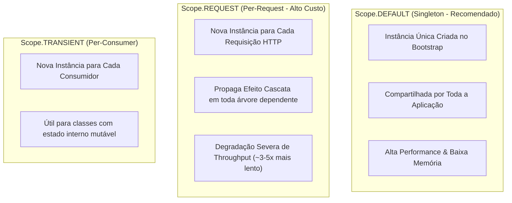

# Injeção de Dependências & Modularidade Avançada no NestJS

A Inversão de Controle (IoC) e a Injeção de Dependência (DI) são a espinha dorsal do NestJS. Este guia aborda o funcionamento profundo do container de injeção, custom providers, escopos e arquitetura modular desacoplada.

---

## 1. Tokens de Injeção: Boas Práticas e Estratégias

No ecossistema NestJS/TypeScript, existem três maneiras principais de definir tokens para injeção:

| Abordagem | Exemplo | Vantagens | Desvantagens |
| :--- | :--- | :--- | :--- |
| **Classes Abstratas (Recomendado)** | `abstract class OrderRepository` | Seguro em refatorações; serve como tipo e token; dispensa `@Inject()` explícito | Nenhuma relevante em projetos TypeScript modernos |
| **Tokens com Symbol** | `const ORDER_REPO = Symbol('ORDER_REPO')` | Imutabilidade e garantia de colisão zero | Requer `@Inject(ORDER_REPO)` em todo construtor |
| **Tokens de String (Legado)** | `'ORDER_REPOSITORY'` | Simples de escrever | Propenso a erros de digitação e colisões acidentais |

### Exemplo com Classe Abstrata (Abordagem Oficial Recomendada):
```typescript
// 1. Definição da abstração (porta)
export abstract class NotificationGateway {
  abstract sendPushNotification(userId: string, message: string): Promise<void>;
}

// 2. Consumo no caso de uso (sem necessidade de decorador @Inject extra)
@Injectable()
export class NotifyUserUseCase {
  constructor(private readonly notificationGateway: NotificationGateway) {}
}

// 3. Vinculação no módulo
@Module({
  providers: [
    NotifyUserUseCase,
    {
      provide: NotificationGateway,
      useClass: FirebaseNotificationGateway,
    },
  ],
})
export class NotificationModule {}
```

---

## 2. Tipos de Providers e Casos de Uso

### 2.1. `useClass`
Vincula um token a uma classe concreta instanciada pelo container:
```typescript
{
  provide: CacheService,
  useClass: RedisCacheService,
}
```

### 2.2. `useFactory`
Ideal para instanciação dinâmica, inicialização assíncrona ou integração com serviços de configuração:
```typescript
{
  provide: 'AMQP_CONNECTION',
  useFactory: async (configService: ConfigService): Promise<amqp.Connection> => {
    const url = configService.getOrThrow<string>('RABBITMQ_URL');
    return amqp.connect(url);
  },
  inject: [ConfigService],
}
```

### 2.3. `useValue`
Injeta objetos literais, configurações estáticas ou mocks durante testes:
```typescript
{
  provide: 'APP_CONFIG',
  useValue: Object.freeze({
    maxBatchSize: 100,
    retryAttempts: 3,
  }),
}
```

---

## 3. Escopos de Injeção (Injection Scopes)

O NestJS suporta três escopos principais controlados pelo decorador `@Injectable({ scope: Scope.DEFAULT })`:



> [!WARNING] **Cuidado com Scope.REQUEST em APIs de Alta Performance**
> Quando um provider é marcado como `Scope.REQUEST`, **todos os controllers e providers que dependem dele se tornam REQUEST-scoped automaticamente**. Isso destrói o benefício do JIT do V8 e causa alocação contínua de objetos e garbage collection agressivo.
> **Alternativa correta:** Mantenha os serviços como `DEFAULT` (Singleton) e passe o contexto da requisição (ex: `tenantId`, `userId`) como argumento nos métodos.

---

## 4. Arquitetura Modular & Dynamic Modules

### 4.1. Tipos de Módulos
1. **Feature Modules:** Encapsulam um subdomínio de negócio coeso (`OrdersModule`, `UsersModule`).
2. **Core / Infrastructure Modules:** Provedores transversais globais (banco de dados, logging, mensageria). Podem utilizar `@Global()` com parcimônia.
3. **Shared Modules:** Componentes utilitários reutilizáveis (interceptors, helpers, pipes compartilhados).

### 4.2. Dynamic Modules (`ConfigurableModuleBuilder`)
Para criar módulos reutilizáveis e altamente configuráveis:

```typescript
import { ConfigurableModuleBuilder } from '@nestjs/common';

export interface StorageModuleOptions {
  bucket: string;
  region: string;
  provider: 's3' | 'gcs' | 'azure';
}

export const { ConfigurableModuleClass, MODULE_OPTIONS_TOKEN } =
  new ConfigurableModuleBuilder<StorageModuleOptions>()
    .setClassMethodName('forRoot')
    .setFactoryMethodName('createStorageOptions')
    .build();

@Module({
  providers: [
    StorageService,
    {
      provide: 'S3_CLIENT',
      useFactory: (options: StorageModuleOptions) => new S3Client(options),
      inject: [MODULE_OPTIONS_TOKEN],
    },
  ],
  exports: [StorageService],
})
export class StorageModule extends ConfigurableModuleClass {}
```

---

## 5. Prevenção e Resolução de Dependências Circulares

Dependências circulares ocorrem quando `ModuleA` depende de `ModuleB` e `ModuleB` depende de `ModuleA`.

### Boas Práticas:
1. **Redesenho Arquitetural (Primeira Opção):** Se dois módulos dependem mutuamente, eles provavelmente pertencem ao mesmo agregado ou precisam de um terceiro módulo mediador (`ModuleC`) contendo os casos de uso compartilhados ou interfaces de eventos.
2. **Arquitetura Orientada a Eventos:** Substitua a chamada direta de serviço por emissão de eventos via `EventEmitter2` ou filas assíncronas.
3. **`forwardRef()` (Apenas como Último Recurso):**
   ```typescript
   @Injectable()
   export class UsersService {
     constructor(
       @Inject(forwardRef(() => OrdersService))
       private readonly ordersService: OrdersService,
     ) {}
   }
   ```
