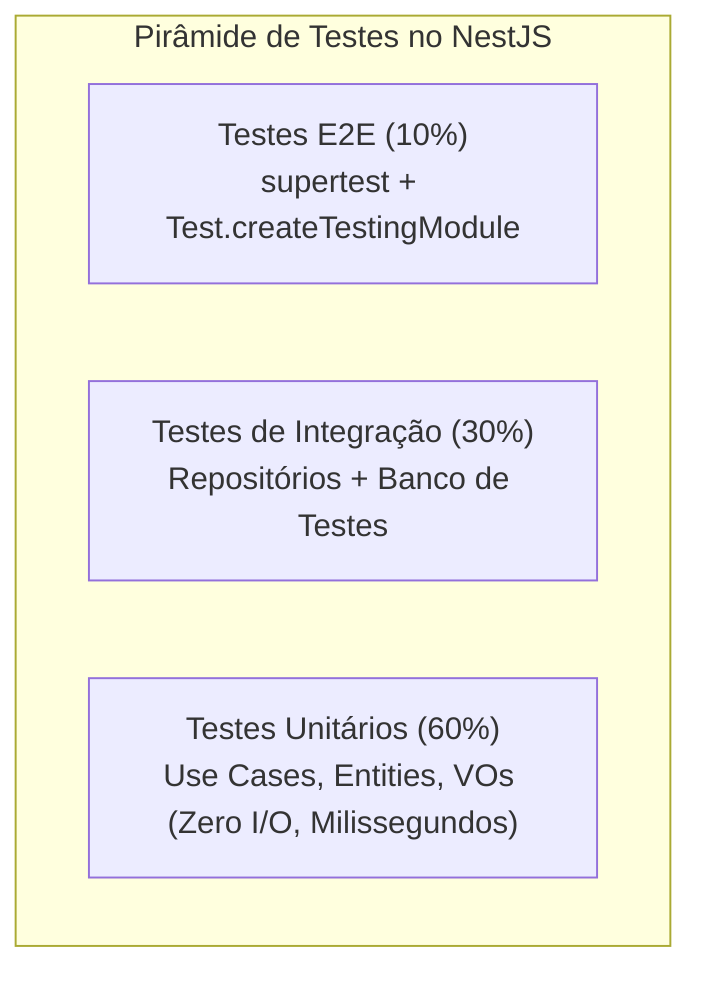

# Padrões de Qualidade & Padrões da Comunidade no NestJS

Construir software para produção exige contratos de entrada rígidos, formatação de erros padronizada, documentação viva de APIs e testes automatizados com cobertura rigorosa.

---

## 1. Validação Estrita de DTOs (`class-validator` + `class-transformer`)

Todo payload de entrada (body, query params, headers, route params) deve ser tipado em uma classe DTO com validação declarativa.

### 1.1. Configuração do `ValidationPipe` no `main.ts`
```typescript
app.useGlobalPipes(
  new ValidationPipe({
    whitelist: true,              // Remove propriedades não declaradas no DTO
    forbidNonWhitelisted: true,   // Lança erro caso campos não permitidos sejam enviados
    transform: true,              // Converte tipos primitivos para instâncias reais de DTO
    transformOptions: {
      enableImplicitConversion: false, // Evita coerções implícitas perigosas
    },
  }),
);
```

### 1.2. Exemplo de DTO Robusto
```typescript
// src/modules/users/presentation/dtos/create-user.dto.ts
import { ApiProperty } from '@nestjs/swagger';
import { IsEmail, IsNotEmpty, IsString, MinLength, MaxLength, Matches } from 'class-validator';
import { Transform } from 'class-transformer';

export class CreateUserDto {
  @ApiProperty({ example: 'Ana Silva', description: 'Nome completo do usuário' })
  @IsString({ message: 'O nome deve ser um texto válido.' })
  @IsNotEmpty({ message: 'O nome é obrigatório.' })
  @MinLength(3, { message: 'O nome deve ter no mínimo 3 caracteres.' })
  @MaxLength(100, { message: 'O nome não pode exceder 100 caracteres.' })
  @Transform(({ value }) => typeof value === 'string' ? value.trim() : value)
  readonly name: string;

  @ApiProperty({ example: 'ana.silva@empresa.com', description: 'E-mail corporativo' })
  @IsEmail({}, { message: 'O e-mail informado é inválido.' })
  @IsNotEmpty({ message: 'O e-mail é obrigatório.' })
  @Transform(({ value }) => typeof value === 'string' ? value.toLowerCase().trim() : value)
  readonly email: string;

  @ApiProperty({ example: 'Senha@Forte2026', minLength: 8 })
  @IsString()
  @MinLength(8, { message: 'A senha deve conter ao menos 8 caracteres.' })
  @Matches(/((?=.*\d)|(?=.*\W+))(?![.\n])(?=.*[A-Z])(?=.*[a-z]).*$/, {
    message: 'A senha deve conter ao menos uma letra maiúscula, uma minúscula e um número ou símbolo.',
  })
  readonly password: string;
}
```

---

## 2. Tratamento Global de Exceções (Padrão RFC 7807)

Nunca retorne stack traces ou mensagens com formato inconsistente para clientes. Crie um `ExceptionFilter` global em conformidade com o padrão internacional **RFC 7807 (Problem Details for HTTP APIs)**:

```typescript
// src/common/filters/rfc7807-exception.filter.ts
import {
  ExceptionFilter,
  Catch,
  ArgumentsHost,
  HttpException,
  HttpStatus,
  Logger,
} from '@nestjs/common';
import { HttpAdapterHost } from '@nestjs/core';
import { DomainException } from '../../modules/common/domain/exceptions/domain.exception';

@Catch()
export class Rfc7807ExceptionFilter implements ExceptionFilter {
  private readonly logger = new Logger(Rfc7807ExceptionFilter.name);

  constructor(private readonly httpAdapterHost: HttpAdapterHost) {}

  catch(exception: unknown, host: ArgumentsHost): void {
    const { httpAdapter } = this.httpAdapterHost;
    const ctx = host.switchToHttp();
    const request = ctx.getRequest();

    let status = HttpStatus.INTERNAL_SERVER_ERROR;
    let title = 'Erro Interno do Servidor';
    let detail = 'Ocorreu um erro inesperado ao processar sua solicitação.';
    let type = 'https://api.empresa.com/errors/internal-server-error';
    let errors: Record<string, string[]> | undefined;

    if (exception instanceof HttpException) {
      status = exception.getStatus();
      const res = exception.getResponse() as any;
      title = exception.name;
      detail = typeof res === 'object' && res.message ? (Array.isArray(res.message) ? res.message.join('; ') : res.message) : exception.message;
      type = `https://api.empresa.com/errors/http-${status}`;
      if (typeof res === 'object' && Array.isArray(res.message)) {
        errors = { validation: res.message };
      }
    } else if (exception instanceof DomainException) {
      status = HttpStatus.UNPROCESSABLE_ENTITY; // 422
      title = 'Violação de Regra de Negócio';
      detail = exception.message;
      type = 'https://api.empresa.com/errors/domain-violation';
    } else {
      this.logger.error('Exceção não tratada capturada:', exception);
    }

    const responseBody = {
      type,
      title,
      status,
      detail,
      instance: httpAdapter.getRequestUrl(request),
      timestamp: new Date().toISOString(),
      ...(errors ? { errors } : {}),
    };

    httpAdapter.reply(ctx.getResponse(), responseBody, status);
  }
}
```

---

## 3. Gestão de Configuração Segura (Fail-Fast) com Zod

Evite que a aplicação suba com variáveis de ambiente ausentes ou incorretas.

```typescript
// src/config/env.schema.ts
import { z } from 'zod';

export const envSchema = z.object({
  NODE_ENV: z.enum(['development', 'production', 'test']).default('development'),
  PORT: z.coerce.number().default(3000),
  DATABASE_URL: z.string().url('DATABASE_URL deve ser uma URL válida de conexão'),
  JWT_SECRET: z.string().min(32, 'JWT_SECRET deve ter ao menos 32 caracteres'),
  REDIS_URL: z.string().url().default('redis://localhost:6379'),
});

export type EnvConfig = z.infer<typeof envSchema>;

// src/config/config.module.ts
@Module({
  imports: [
    ConfigModule.forRoot({
      isGlobal: true,
      validate: (config: Record<string, unknown>) => {
        const parsed = envSchema.safeParse(config);
        if (!parsed.success) {
          console.error('❌ Falha na validação de variáveis de ambiente:', parsed.error.format());
          throw new Error('Configuração de ambiente inválida.');
        }
        return parsed.data;
      },
    }),
  ],
})
export class AppConfigModule {}
```

---

## 4. Documentação OpenAPI / Swagger

Adicione documentação viva de forma declarativa:

```typescript
// src/main.ts
const config = new DocumentBuilder()
  .setTitle('Enterprise NestJS API')
  .setDescription('Documentação OpenAPI dos serviços e microsserviços da plataforma')
  .setVersion('1.0.0')
  .addBearerAuth()
  .build();

const document = SwaggerModule.createDocument(app, config);
SwaggerModule.setup('docs', app, document);
```

---

## 5. Estratégia de Testes e Guardrail de Cobertura (Mínimo: 80%)



### 5.1. Teste Unitário de Use Case com Mocks
```typescript
// src/modules/orders/application/use-cases/create-order.use-case.spec.ts
import { describe, it, expect, vi, beforeEach } from 'vitest';
import { CreateOrderUseCase } from './create-order.use-case';
import { OrderRepository } from '../ports/order.repository';
import { PaymentGateway } from '../ports/payment.gateway';

describe('CreateOrderUseCase', () => {
  let sut: CreateOrderUseCase;
  let orderRepositoryMock: Partial<OrderRepository>;
  let paymentGatewayMock: Partial<PaymentGateway>;

  beforeEach(() => {
    orderRepositoryMock = {
      save: vi.fn().mockResolvedValue(undefined),
    };
    paymentGatewayMock = {
      process: vi.fn().mockResolvedValue({ transactionId: 'tx-123' }),
    };

    sut = new CreateOrderUseCase(
      orderRepositoryMock as OrderRepository,
      paymentGatewayMock as PaymentGateway,
    );
  });

  it('deve criar e persistir um pedido com sucesso quando dados forem válidos', async () => {
    // Arrange
    const command = {
      customerId: 'cust-1',
      items: [{ name: 'Livro', price: 50, quantity: 2 }],
      paymentToken: 'tok-abc',
    };

    // Act
    const result = await sut.execute(command);

    // Assert
    expect(result.orderId).toBeDefined();
    expect(result.transactionId).toBe('tx-123');
    expect(orderRepositoryMock.save).toHaveBeenCalledTimes(1);
    expect(paymentGatewayMock.process).toHaveBeenCalledTimes(1);
  });
});
```

### 5.2. Configuração de Thresholds Mandatórios no Test Runner
No `vitest.config.ts` (ou `jest.config.ts`), lembre-se da regra crítica documentada em `MEMORY.md`: declare as propriedades de thresholds **diretamente**, sem encapsular em `global: {}`:

```typescript
// vitest.config.ts
export default defineConfig({
  test: {
    coverage: {
      provider: 'v8',
      reporter: ['text', 'json-summary', 'html'],
      thresholds: {
        lines: 80,
        statements: 80,
        functions: 80,
        branches: 80,
      },
    },
  },
});
```
