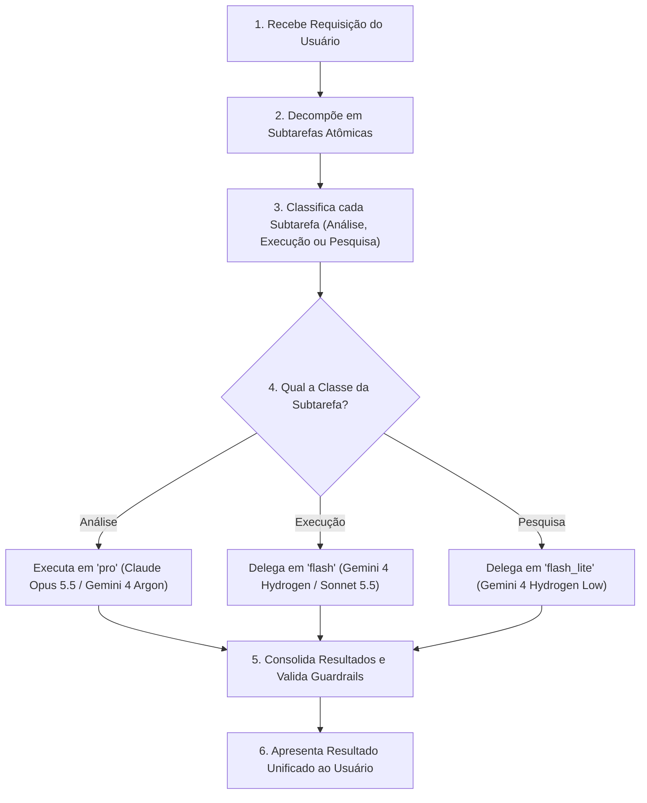

# Orchestrator Skill: Decomposição e Roteamento Inteligente de Tarefas

Esta skill transforma o agente em um **Orquestrador de Engenharia de IA**, capaz de decompor requisições complexas, classificar cada subtarefa por natureza cognitiva e rotear para o modelo mais adequado — maximizando qualidade analítica e velocidade de execução.

---

## Quando Ativar Esta Skill

1. Tarefas complexas que envolvam **análise** (arquitetura, code review, decisão de design) combinada com **execução** (escrita de código, testes, refatoração).
2. Requisições que beneficiem de **paralelismo** — ex: "refatore o módulo X e crie testes para Y".
3. Projetos novos (*greenfield*) que exijam planejamento arquitetural seguido de scaffold de código.
4. Auditorias de codebase que exijam análise profunda e correção simultânea.

---

## Modelo de Roteamento por Capacidade (Model Routing Table)

O roteamento segue o princípio de **especialização cognitiva**: modelos de raciocínio profundo para análise, arquitetura e orquestração; modelos de alta vazão e velocidade para execução, geração de código e varredura.

### Catálogo Ativo de Modelos no Antigravity

| Família | Identificadores (`model` no Swarm / UI) | Perfil Cognitivo & Papel no Harness |
| :--- | :--- | :--- |
| **Gemini 4 Argon** | `gemini-pro-orchestrator-g1-pro` (*Orchestrator Argon*) `gemini-4-argon-high` / `medium` / `low` | **Orquestração Central, Arquitetura & Raciocínio Profundo.** Flagship da geração Gemini 4 com variante dedicada de coordenação e alta disponibilidade de cota. |
| **Gemini 4 Hydrogen** | `gemini-4-hydrogen-xhigh` / `high` `gemini-4-hydrogen-medium` / `low` | **Execução Rápida de Nova Geração.** Codificação veloz, testes automatizados, refatoração guiada e exploração de codebase com 4 níveis de esforço. |
| **Claude 5.5 Opus** | `claude-opus-5-5-high` / `medium` / `low` | **Análise Crítica, SDD (`spec.md`/`plan.md`) & Auditoria.** Raciocínio em cadeia para decisões arquiteturais complexas, code review rigoroso e modelagem formal. |
| **Claude 5.5 Sonnet** | `claude-sonnet-5-5-high` / `medium` / `low` | **Implementação Full-Stack Complexa.** Equilíbrio entre raciocínio estrutural e escrita de código denso. |
| **Gemini 3.8 Flash** | `gemini-3.8-flash-high` / `medium` / `low` | **Execução Econômica & Fallback.** Mantido para tarefas mecânicas rápidas e contingência de cota. |

### Matriz de Roteamento por Classe de Tarefa

| Classe de Tarefa | Modelo Primário Recomendado | Alternativa / Failover de Cota | Tier (`invoke_subagent`) | ID Direto (`swarm`) |
| :--- | :--- | :--- | :--- | :--- |
| **Orquestração Central** | **Orchestrator (Argon)** / **Gemini 4 Argon (High)** | Claude Opus 5.5 (High) | `inherit` / `pro` | `gemini-pro-orchestrator-g1-pro` / `gemini-4-argon-high` |
| **Análise Arquitetural & SDD** | **Claude Opus 5.5 (High)** / **Gemini 4 Argon (High)** | Claude Sonnet 5.5 (High) | `pro` | `claude-opus-5-5-high` / `gemini-4-argon-high` |
| **Code Review & Auditoria** | **Claude Opus 5.5 (High)** / **Gemini 4 Argon (High)** | Claude Sonnet 5.5 (High) | `pro` | `claude-opus-5-5-high` / `gemini-4-argon-high` |
| **Planejamento de Testes** | **Gemini 4 Argon (High)** / **Claude Opus 5.5 (High)** | Gemini 4 Argon (Medium) | `pro` | `gemini-4-argon-high` / `claude-opus-5-5-high` |
| **Implementação Complexa** | **Gemini 4 Argon (Medium)** / **Claude Sonnet 5.5 (High)** | Gemini 4 Hydrogen (XHigh) | `inherit` / `pro` | `gemini-4-argon-medium` / `claude-sonnet-5-5-high` |
| **Geração de Código & Features** | **Gemini 4 Hydrogen (High / XHigh)** | Gemini 3.8 Flash (High) | `flash` | `gemini-4-hydrogen-high` / `gemini-4-hydrogen-xhigh` |
| **Refatoração Guiada** | **Gemini 4 Hydrogen (High)** | Gemini 3.8 Flash (High) | `flash` | `gemini-4-hydrogen-high` |
| **Escrita de Testes (AAA)** | **Gemini 4 Hydrogen (High)** | Gemini 3.8 Flash (High) | `flash` | `gemini-4-hydrogen-high` |
| **Correção de Bugs Pontuais** | **Gemini 4 Hydrogen (High)** | Claude Sonnet 5.5 (Medium) | `flash` | `gemini-4-hydrogen-high` |
| **Documentação Técnica** | **Gemini 4 Hydrogen (Medium / High)** | Gemini 3.8 Flash (High) | `flash` | `gemini-4-hydrogen-medium` |
| **Pesquisa de Codebase** | **Gemini 4 Hydrogen (Low)** | Gemini 3.8 Flash (Low) | `flash_lite` | `gemini-4-hydrogen-low` |

---

## Mecanismos de Invocação no Antigravity (`invoke_subagent` vs `swarm`)

O Antigravity oferece duas APIs distintas para delegação de trabalho, cada uma com sua semântica de seleção de modelo:

1. **Subagentes Hierárquicos (`invoke_subagent`):**
   - Aceita **tiers abstratos** no parâmetro `Model`: `"inherit"`, `"pro"`, `"flash"` ou `"flash_lite"`.
   - Use `"pro"` para tarefas da classe **ANÁLISE**, `"flash"` para **EXECUÇÃO**, `"flash_lite"` para **PESQUISA**, ou `"inherit"` para herdar o modelo ativo selecionado pelo usuário na sessão (ex: *Gemini 4 Argon*).
2. **Native Swarm (`swarm` — Agentes Paralelos no Message Board):**
   - Aceita o **ID explícito do modelo** (ex: `model: "gemini-4-argon-high"`, `model: "gemini-4-hydrogen-high"`, `model: "claude-opus-5-5-high"`). Por padrão, omitir `model` no `swarm{action: "add"}` mantém o worker no modelo da conversa atual.
   - **Failover Dinâmico de Cota:** Consulte `swarm{action: "models"}` para inspecionar `quota_remaining`. Caso uma família esgote a cota durante a execução, migre o worker sem perda de contexto via `swarm{action: "model", name: "<worker>", model: "gemini-4-argon-high"}`.

> **Regra de Fallback:** Se o modelo preferencial não estiver disponível ou o usuário não tiver especificado troca de modelo, utilize `inherit` (herda o modelo ativo da conversa).

---

## Protocolo de Orquestração (Passo a Passo)

### Passo 1: Recepção e Compreensão
- Leia a requisição completa do usuário.
- Identifique o escopo, os projetos envolvidos e as restrições explícitas.

### Passo 2: Decomposição em Subtarefas
- Quebre a requisição em **subtarefas atômicas independentes** (quando possível) ou em **subtarefas sequenciais** (quando há dependência de dados).
- Cada subtarefa deve ter: **Objetivo claro**, **Artefatos de entrada** e **Critério de conclusão**.

### Passo 3: Classificação e Roteamento
Classifique cada subtarefa usando a taxonomia:

**Classe ANÁLISE (→ `pro`):**
- Decisões arquiteturais com trade-offs
- Revisão de código existente
- Diagnóstico de bugs complexos
- Planejamento de estratégia de testes
- Avaliação de riscos e segurança

**Classe EXECUÇÃO (→ `flash`):**
- Geração de código seguindo um plano definido
- Escrita de testes unitários seguindo padrão AAA
- Refatoração mecânica (extrair método, renomear, mover)
- Criação de documentação e scaffolding
- Correção de bugs com causa raiz já identificada

**Classe PESQUISA (→ `flash_lite`):**
- Buscar definições de tipos, imports e dependências no codebase
- Varrer arquivos para mapear estrutura do projeto
- Localizar usos de uma função ou padrão específico

### Passo 4: Execução e Delegação
- **Subtarefas de análise:** Execute diretamente (o orquestrador já deve estar rodando no modelo `pro`).
- **Subtarefas de execução:** Delegue via `invoke_subagent` com `Model: "flash"`.
- **Subtarefas de pesquisa:** Delegue via `invoke_subagent` com `Model: "flash_lite"` ou use subagentes `research`.
- **Subtarefas paralelas** (sem dependência entre si): Lance múltiplos subagentes simultaneamente.
- **Subtarefas sequenciais** (output de uma alimenta outra): Execute em cadeia, consolidando resultados intermediários.

### Passo 5: Consolidação
- Reúna os resultados de todos os subagentes.
- Valide coerência entre os artefatos gerados.
- Resolva conflitos se subagentes divergirem.

### Passo 6: Entrega
- Apresente o resultado unificado ao usuário com links para os arquivos criados/modificados.
- Destaque decisões arquiteturais tomadas e seu raciocínio.

---

## Guias Detalhados

- 📖 **[Padrões de Decomposição de Tarefas](./references/decomposition-patterns.md):** Templates para decompor cenários comuns (feature nova, refatoração, migração, auditoria).
- 📖 **[Exemplos de Roteamento em Ação](./references/routing-examples.md):** Casos práticos com fluxo completo de orquestração.
