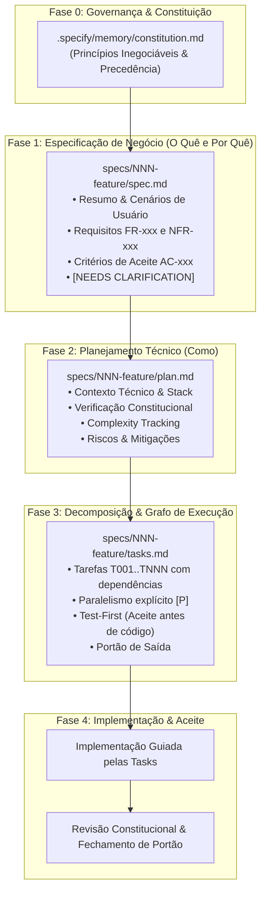

# Spec-Driven Development (SDD) Skill: Engenharia Guiada por Especificação

Esta skill formaliza a metodologia de **Spec-Driven Development (SDD)**, transformando o desenvolvimento de software em um processo determinístico, auditável e desacoplado de suposições.

---

## Quando Utilizar Esta Skill

Consulte e ative esta skill ao:
1. Planejar ou conceber uma **nova funcionalidade (feature)** ou módulo antes de iniciar a implementação.
2. Definir a **Constituição de Engenharia** de um projeto novo ou existente (`.specify/memory/constitution.md`).
3. Redigir especificações de produto claras e precisas em `spec.md`, sem misturar requisitos de negócio com detalhes de implementação.
4. Elaborar planos de arquitetura técnica em `plan.md` com análise de riscos, verificação constitucional e tracking de complexidade.
5. Decompor projetos em `tasks.md` ordenadas por dependência com identificação de paralelismo seguro `[P]` e portões de saída.
6. Resolver pontos de ambiguidade de forma explícita com a sintaxe `[NEEDS CLARIFICATION: pergunta]`.
7. Conectar projetos à pasta padrão `specs/` com governança rastreável.

---

## 1. Fluxo do Ciclo de Vida SDD



---

## 2. A Tríade de Documentos por Feature (`specs/NNN-feature/`)

Toda iniciativa de desenvolvimento deve ser isolada em sua própria pasta numerada sequencialmente (`specs/001-nome/`, `specs/002-nome/`) contendo os 3 arquivos essenciais:

| Documento | Foco Primário | Pergunta Central | Audiência | Regra Inegociável |
| :--- | :--- | :--- | :--- | :--- |
| **`spec.md`** | Negócio / Comportamento | **O quê** e **Por quê**? | Produto, Negócio, QA | Nenhuma suposição silenciosa; dúvidas viram `[NEEDS CLARIFICATION]`. |
| **`plan.md`** | Arquitetura / Decisões | **Como** construir? | Liderança Técnica, Arquitetos | Desvios constitucionais DEVEM ser justificados em *Complexity Tracking*. |
| **`tasks.md`** | Execução / Decomposição | **Quando** e em qual **ordem**? | Engenheiros e Agentes Executores | Testes de aceite precedem código; tarefas com `[P]` apenas para recursos disjuntos. |

---

## 3. Diretrizes de Redação de `spec.md`

1. **Linguagem de Negócio:** Escreva em termos do problema do usuário. Proibido citar tabelas de banco, bibliotecas npm/pub, endpoints específicos ou nomes de classes.
2. **Identificadores Estáveis:**
   - Requisitos Funcionais: `FR-001`, `FR-002`, ...
   - Requisitos Não Funcionais: `NFR-001`, `NFR-002`, ...
   - Critérios de Aceite: `AC-001`, `AC-002`, ...
   - Perguntas Abertas: `Q-001`, `Q-002`, ...
3. **Tratamento de Incertezas:**
   ```markdown
   | ID | Pergunta | Bloqueia | Responsável |
   |---|---|---|---|
   | Q-001 | `[NEEDS CLARIFICATION: Qual o limite de upload de arquivos CSV no plano gratuito?]` | Sim | Produto |
   ```

---

## 4. Diretrizes de Redação de `plan.md`

1. **Verificação Constitucional:** Todo plano deve avaliar expressamente os princípios fundamentais da constituição:
   ```markdown
   ## 2. Verificação constitucional
   | Princípio | Aplicação nesta feature | Situação |
   |---|---|---|
   | I — Contratos normativos antes de código | Contrato OpenAPI atualizado no PR | OK |
   | II — Aritmética decimal determinística | Utilizado BigDecimal em cálculos | OK |
   | VI — Isolamento do proprietário | RLS forçado por tenant_id | OK |
   ```
2. **Complexity Tracking (Rastreabilidade de Complexidade):**
   - Se uma solução mais complexa for escolhida em vez de uma abordagem simples, ou se houver um desvio aceito de princípio, registre:
     - Qual é o desvio.
     - Por que é necessário.
     - A alternativa mais simples descartada e o motivo técnico.

---

## 5. Diretrizes de Redação de `tasks.md`

1. **Rastreabilidade Bidirecional:** Cada tarefa cita expressamente o requisito que atende:
   ```markdown
   | ID | Tarefa | Atende | Depende de |
   |---|---|---|---|
   | T001 `[P]` | Criar contrato OpenAPI do endpoint /conciliacao | FR-001, AC-001 | — |
   | T002 | Escrever teste de aceite para upload de arquivo com conflito | AC-002 | T001 |
   | T003 | Implementar serviço de parser de arquivo CSV | FR-001 | T002 |
   ```
2. **Convenção `[P]` de Paralelismo:** Use `[P]` **apenas** quando os arquivos criados ou modificados forem totalmente independentes de outras tarefas paralelas.
3. **Test-First Obrigatório:** O teste de aceite ou contrato (ex: `T002`) deve preceder a implementação da regra (ex: `T003`).

---

## 6. Governança e Portão de Saída

Nenhuma etapa ou branch de feature pode ser considerada pronta sem a aprovação do **Portão de Saída**:
- [ ] Todos os critérios de aceite (`AC-xxx`) executados com evidência documentada.
- [ ] Contratos normativos (OpenAPI, DDL, schemas) sincronizados na mesma entrega.
- [ ] Verificação constitucional sem desvios não justificados.
- [ ] Guardrails de cobertura de testes mínimos de 80% superados.

---

## 📚 Guias Detalhados & Templates

Acesse os guias complementares e modelos prontos para uso:

- 📖 **[Ciclo de Vida e Artefatos da Spec](./references/spec-lifecycle-and-artifacts.md):** Guia aprofundado sobre a estrutura de pastas `specs/`, fluxo de estados e artefatos de apoio (`data-model.md`, `contracts/`, `research.md`).
- 📖 **[Constituição e Governança](./references/constitution-and-governance.md):** Como redigir princípios inegociáveis, gerenciar precedências normativas e aplicar o *Complexity Tracking*.
- 📖 **[Guia de Redação de Specs](./references/authoring-specs-and-plans.md):** Boas práticas de decomposição, cenários BDD/Gherkin, eliminação de ambiguidades e grafos de tarefas.
- 📋 **[Templates SDD Prontos para Uso](./templates/):**
  - [Template de Spec (`spec-template.md`)](./templates/spec-template.md)
  - [Template de Plano (`plan-template.md`)](./templates/plan-template.md)
  - [Template de Tarefas (`tasks-template.md`)](./templates/tasks-template.md)
  - [Template de Constituição (`constitution-template.md`)](./templates/constitution-template.md)
