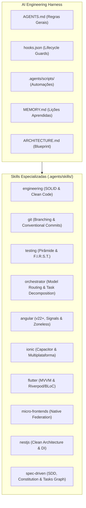

# Blueprint de Arquitetura de Software & Contexto do Sistema

Este documento serve como a **Fonte Única da Verdade Arquitetural** (*Single Source of Truth*) para agentes de IA e engenheiros humanos atuando neste ecossistema.

---

## 1. Visão Geral do Ecossistema

O repositório **AI-Engineering** atua como um **Harness Central de Engenharia de IA** e repositório de inteligência corporativa. Ele provê padrões arquiteturais, automações e pacotes de habilidades (*skills*) operadas via *Progressive Disclosure*.

---

## 2. Padrões Arquiteturais por Plataforma

### 2.1. Web Corporativo (Angular 22+)
- **Paradigma:** Standalone Components, Zoneless Change Detection (`provideExperimentalZonelessChangeDetection()`).
- **Estado:** Signals reativos nativos (`signal()`, `computed()`, `linkedSignal()`) e NgRx SignalStore para estado compartilhado.
- **Renderização:** Novo Control Flow (`@if`, `@for`, `@switch`, `@defer`).

### 2.2. Mobile Multiplataforma Híbrido (Ionic & Capacitor)
- **Paradigma:** Single Web Codebase com ponte nativa Capacitor.
- **Navegação:** Stack Navigation com ciclo de vida Ionic (`ionViewWillEnter`, `ionViewDidLeave`).
- **Estilização:** CSS Shadow Parts e Custom Properties (`--background`, `--color`).

### 2.3. Mobile Multiplataforma Nativo (Flutter & Dart)
- **Paradigma:** MVVM (Model-View-ViewModel).
- **Gerenciamento de Estado:** Riverpod (padrão principal) com `AsyncNotifier` ou BLoC/Cubit para fluxos de negócio complexos.
- **Design:** Material 3 declarativo e responsivo.
  - **Agente Especialista Responsável:** [`flutter-expert`](.agents/agents/flutter-expert.md) para design, implementação de push notifications, resiliência offline, regras Firestore e guardrails de qualidade.

### 2.4. Arquitetura Distribuída (Micro-Frontends)
- **Paradigma:** Native Federation com esbuild.
- **Shell vs Remotes:** Shell orquestra autenticação e layout principal; Remotes expõem recursos desacoplados.
- **Comunicação:** Custom Events isolados, contratos TypeScript compartilhados e tolerância a falhas (Fallbacks/Error Boundaries).

### 2.5. Backend Corporativo & Microsserviços (NestJS & Node.js)
- **Paradigma:** Clean Architecture / Hexagonal (Ports & Adapters) segregando Domain (puro), Application (Use Cases), Infrastructure (Prisma/TypeORM/Redis) e Presentation (REST/GraphQL/gRPC).
- **Inversão de Dependências:** Contratos abstratos (`abstract class`) como tokens de injeção, desacoplando Use Cases de bancos e serviços externos.
- **Escalabilidade & Performance:** Fastify Engine para alto throughput de I/O, processamento assíncrono em segundo plano com BullMQ e Redis, e Cache-Aside distribuído.
- **Qualidade & Resiliência:** DTOs com `class-validator` estrito, tratamento RFC 7807 Problem Details, configuração fail-fast com Zod, e guardrail de cobertura >= 80%.
  - **Agente Especialista Responsável:** [`nestjs-expert`](.agents/agents/nestjs-expert.md).

### 2.6. Metodologia de Requisitos & Governança (Spec-Driven Development - SDD)
- **Paradigma:** Governança por Especificação Formal inspirada no modelo `valor-real/specs`.
- **Constituição de Engenharia:** `.specify/memory/constitution.md` define leis e precedências normativas inegociáveis.
- **Tríade de Artefatos:** Cada entrega é documentada em `specs/NNN-feature/` contendo `spec.md` (o quê/por quê em linguagem de negócio com `[NEEDS CLARIFICATION]`), `plan.md` (como, verificação constitucional e tracking de complexidade) e `tasks.md` (grafo de dependências com paralelismo `[P]` e Test-First).
  - **Agente Especialista Responsável:** [`spec-driven-expert`](.agents/agents/spec-driven-expert.md).

---

## 3. Diretrizes de Integração de Novos Projetos

Ao conectar um novo repositório a este harness:
1. Execute `.agents/scripts/repo-map.ps1 -ProjectPath <caminho>` para mapear a stack e topologia.
2. Copie ou sincronize os arquivos necessários via `.agents/scripts/sync-projects.ps1` ou instale globalmente com `.agents/scripts/sync-global.ps1`.
3. Adicione particularidades de negócio ou versões de libs em `MEMORY.md`.
